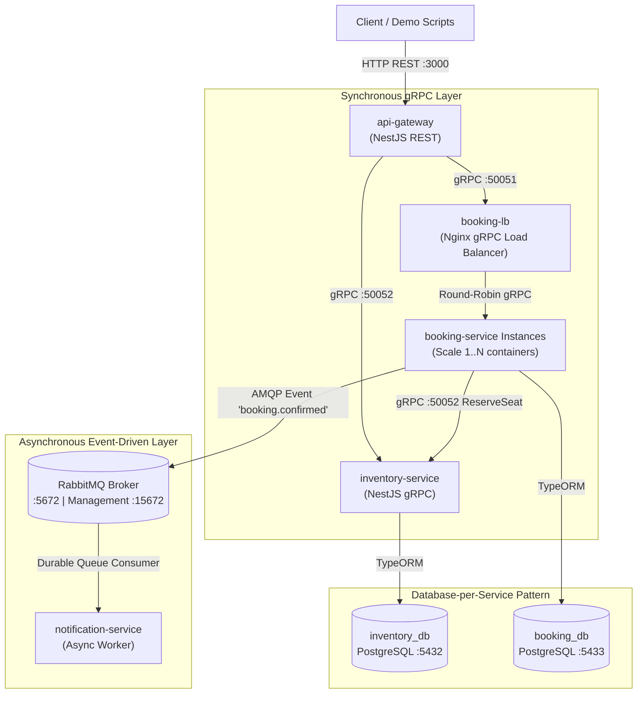

# Hệ Thống Đặt Vé Xem Phim Phân Tán (Distributed Movie Booking System)

> **Báo cáo Thực hành & Đồ án Môn học:** Các Hệ Thống Phân Tán (Distributed Systems)  
> **Kiến trúc:** Microservices, Event-Driven Architecture, Database-per-service  
> **Công nghệ cốt lõi:** NestJS, TypeScript, gRPC, RabbitMQ, PostgreSQL, Nginx, Docker & Docker Compose.

---

## 🏛️ 1. Kiến Trúc Tổng Thể Hệ Thống

Hệ thống được thiết kế theo đúng mô hình kiến trúc phân tán chuẩn doanh nghiệp:

### 📐 Sơ Đồ Kiến Trúc (Mermaid Diagram)



### 📐 Sơ Đồ ASCII Art

```text
[ Client / Demo Scripts ]
           │
           ▼ HTTP REST (Port 3000)
┌─────────────────────────────────────────────────────────────────┐
│                          api-gateway                            │
│           (Cổng vào duy nhất - Transparency Layer)              │
└────────────────┬───────────────────────────────┬────────────────┘
                 │ gRPC (:50051)                 │ gRPC (:50052)
                 ▼                               ▼
┌─────────────────────────────────┐ ┌─────────────────────────────┐
│           booking-lb            │ │      inventory-service      │
│   (Nginx gRPC Load Balancer)    │ │ (Pessimistic / Optimistic)  │
└────────────────┬────────────────┘ └──────────────┬──────────────┘
                 │ Round-Robin gRPC                │
                 ▼                                 ▼
┌─────────────────────────────────┐ ┌─────────────────────────────┐
│     booking-service (1..N)      │ │   DB: inventory_db (5432)   │
│   (Scale-out 1..3 instances)    │ └─────────────────────────────┘
└────────┬─────────────────┬──────┘
         │                 │ gRPC Call (ReserveSeat)
         │                 └───────────────────────────────┐
         │                                                 ▼
         ▼ AMQP Event (booking.confirmed)    (Xác nhận giữ chỗ ghế)
┌─────────────────────────────────┐
│            RabbitMQ             │
│    (Durable Message Broker)     │
└────────────────┬────────────────┘
                 │ Consume Event
                 ▼
┌─────────────────────────────────┐
│      notification-service       │
│    (Async Worker - Decoupled)   │
└─────────────────────────────────┘
```

---

## 🌟 2. Ánh Xạ 7 Đặc Trưng Của Hệ Thống Phân Tán Vào Dự Án

| STT | Đặc Trưng Phân Tán | Thành Phần Triển Khai Thực Tế | Giá Trị Minh Chứng |
| :--- | :--- | :--- | :--- |
| **1** | **Transparency** *(Tính trong suốt)* | `api-gateway` làm facade duy nhất | Client chỉ gọi `POST /booking`, hoàn toàn ẩn giấu 4 microservices, 2 DB, gRPC và RabbitMQ phía sau. |
| **2** | **Openness** *(Tính mở)* | `shared/protos/*.proto` | Chuẩn IDL Protobuf v3 cho phép bất kỳ ngôn ngữ nào (Go, Java, Rust) kết nối mà không đổi kiến trúc. |
| **3** | **Concurrency Control** *(Chống trùng vé)* | `inventory-service` (Pessimistic & Optimistic) | Giải quyết triệt để xung đột khi 10 người cùng đặt 1 ghế cuối. Hỗ trợ cả 2 cơ chế khoá. |
| **4** | **Scalability** *(Khả năng mở rộng)* | `docker compose up --scale booking-service=3` & Nginx | Mở rộng ngang các instance xử lý đơn hàng, Nginx round-robin gRPC tự động phát hiện container mới. |
| **5** | **Fault Tolerance & Partial Failure** | `RabbitMQ` durable queue & `notification-service` | Tắt notification-service giữa chừng, luồng đặt vé vẫn hoàn tất; khi bật lại, worker tự xử lý bù. |
| **6** | **Asynchronous Decoupling** | Message Pattern `booking.confirmed` qua AMQP | Tách rời thời gian xử lý: Đặt vé phản hồi tức thì, gửi email hoá đơn được đẩy về hậu trường. |
| **7** | **No Global Clock** | Microsecond Timestamp logging ở từng container | Minh chứng độ trễ mạng và sai lệch thời gian vật lý giữa các process/container độc lập. |

---

## 🚀 3. Triển Khai Trên 3 Máy (2 máy vật lý + Node 3 trọng tài, cùng Wi-Fi)

Yêu cầu: Docker Desktop + Node.js ≥ 18 trên cả 3 máy. Hướng dẫn chi tiết (firewall, hotspot, phân vai, xử lý sự cố) ở [`DEMO-GUIDE.md`](DEMO-GUIDE.md). Sơ đồ: [`diagrams/01_tong_the_he_thong_phan_tan.png`](diagrams/01_tong_the_he_thong_phan_tan.png).

```bash
node deploy/cluster.mjs ip                                     # xem IP Wi-Fi của máy này
node deploy/cluster.mjs init <IP_MAY_1> <IP_MAY_2> <IP_NODE_3>  # chạy trên CẢ 3 máy, cùng giá trị
node deploy/cluster.mjs up 1                                   # MÁY 1: Primary + Redis Master + RabbitMQ #1
node deploy/cluster.mjs up 3                                   # NODE 3: Witness ×2 + RabbitMQ #3 + Frontend LB
node deploy/cluster.mjs up 2                                   # MÁY 2: Standby + Redis Replica + RabbitMQ #2
node deploy/cluster.mjs status                                 # ai đang là Primary, quorum mấy/3
node deploy/cluster.mjs failback                               # (máy 1) đưa Primary về máy 1 sau demo failover
node demo/00-preflight.mjs                                     # kiểm tra toàn cụm
```

Chỉ có 1 laptop để tập dượt: `node deploy/cluster.mjs init --rehearsal` rồi `node deploy/cluster.mjs up all`.

| Thư mục | Nội dung |
| :--- | :--- |
| `deploy/node1`, `node2`, `node3` | Docker Compose cho từng máy (+ `lan.yml` khi chạy thật, `rehearsal.yml` khi tập dượt 1 máy) |
| `db-cluster/` | Image PostgreSQL 15 + repmgr: tự clone Standby, bỏ phiếu đồng thuận, tự failover, Primary cũ tự hạ cấp + `pg_rewind` |
| `deploy/pg-router/` | Định tuyến ghi tới Primary hiện tại; mất quorum (< 2/3) thì tự chặn ghi. `GET :8008/status` |
| `deploy/rabbitmq/` | Cấu hình cụm RabbitMQ 3 nút, quorum queue luôn đủ 3 bản sao |
| `deploy/windows/open-firewall.ps1` | Mở cổng LAN trên Windows Firewall cho từng máy |

| Địa chỉ | Máy 1 | Máy 2 | Node 3 |
| :--- | :--- | :--- | :--- |
| Frontend LB (client) + Demo Console | — | — | `:8090` |
| API Gateway | `:3000` | `:3100` | — |
| PostgreSQL inventory / booking | `:5501` / `:5502` | `:5511` / `:5512` | witness `:5503` / `:5504` |
| pg-router status | `:8008/status` | `:8018/status` | — |
| RabbitMQ UI (guest/guest) | `:15674` | `:15684` | `:15694` |

Chạy nhanh trên 1 máy (phát triển, không có replication): `docker compose up -d --build` → `http://localhost:3000`.

---

## 🎬 4. Bộ Demo Đặc Trưng Hệ Phân Tán

```bash
node demo/run.mjs            # menu chọn kịch bản (chạy trên Node 3)
node demo/run.mjs 5          # chạy thẳng kịch bản 5
node demo/run.mjs all --auto # chạy toàn bộ để tập dượt
```

| # | Kịch bản | Đặc trưng |
| :---: | :--- | :--- |
| 01 | Một địa chỉ duy nhất — 2 máy vật lý phía sau | Transparency |
| 02 | 10 khách ở 2 máy giành ghế cuối A20 (pessimistic / optimistic) | Concurrency control |
| 03 | Dịch vụ email & một nút RabbitMQ chết — máy 2 tiếp quản, không mất email | Fault tolerance + Async (Raft) |
| 04 | Đứt mạng máy 1 ↔ máy 2 — Node 3 phủ quyết, không sinh 2 Primary | Chống split-brain |
| 05 | Primary máy 1 sập — máy 2 tự thăng cấp, máy 1 quay lại tự về Standby | Auto-failover + fencing |
| 06 | Bán ở máy 1 — máy 2 thấy "đã bán" sau vài ms | Replication / chống vé ma |
| 07 | Đo độ lệch đồng hồ 2 máy bằng thuật toán Cristian | No global clock |
| 08 | Nhân bản booking-service ×3 + cache-aside (bổ sung) | Scalability |
| 09 | Dịch vụ kho ghế chết — circuit breaker ngắt mạch (bổ sung) | Fault tolerance |
| 10 | Tắt Wi-Fi máy 1 — máy 1 tự chặn ghi, máy 2 lên thay, nối lại tự về Standby | Partition + self-fencing |

**Demo Console** `http://<IP Node 3>:8090/`: sơ đồ ghế + 10 khách tranh A20; tab *Trạng thái cụm* hiển thị trực tiếp Primary/Standby/Witness.

Demo bổ trợ lý thuyết Chương 3 (luồng, container): `demo/extra-chuong3/`, chạy với `docker-compose.yml` gốc.

---

## 📖 5. Hướng Dẫn Demo Chi Tiết

Kịch bản thuyết trình từng bước (phân vai, câu chốt, số liệu đo thật, xử lý sự cố, câu hỏi hội đồng): 👉 [`DEMO-GUIDE.md`](DEMO-GUIDE.md)

---

## 🔌 6. Danh Mục REST API Gateway

| Method | Endpoint | Mô tả | Trạng thái phản hồi |
| :--- | :--- | :--- | :--- |
| `GET` | `/health` | Kiểm tra trạng thái gateway (kèm `nodeId`) | 200 OK |
| `GET` | `/movies/:showtimeId` | Xem thông tin suất chiếu và danh sách 20 ghế | 200 OK |
| `POST` | `/booking` | Đặt vé xem phim (Body: `{ showtimeId, seatId, userName }`) | 201 Created / 409 Conflict |
| `GET` | `/booking/:id` | Tra cứu chi tiết vé theo ID | 200 OK / 404 Not Found |
| `POST` | `/dev/reset` | Đưa trạng thái ghế A20 về trống để demo lại | 200 OK |
| `GET` | `/health/deep` | Trạng thái circuit breaker của gateway | 200 OK |
| `GET` | `/lab/cluster` | Ảnh chụp máy này: Primary/Standby, repmgr, Redis, hàng đợi, circuit, bản sao booking | 200 OK |
| `POST` | `/lab/lock-strategy?mode=optimistic` | Đổi chiến lược khoá của inventory-service lúc đang chạy | 200 OK |
| `GET` | `/lab/runtime`, `/lab/block`, `/lab/offload`, `/lab/slow` | Phục vụ demo bổ trợ Chương 3 (luồng, container) | 200 OK |
# cachethongphantan-datvexemphim
